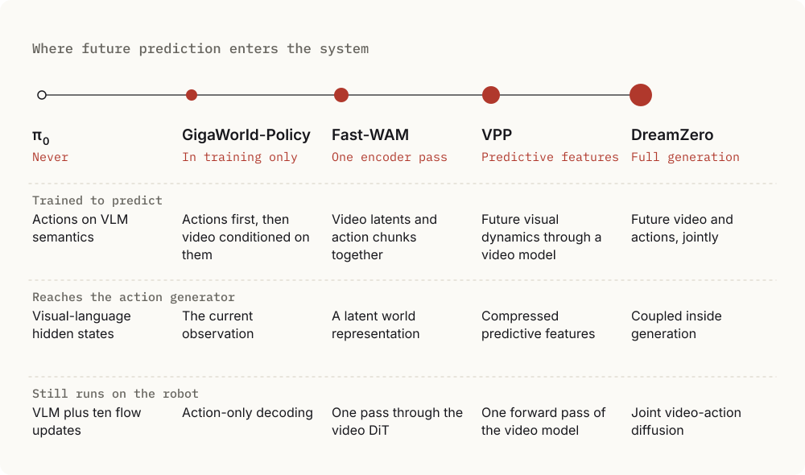
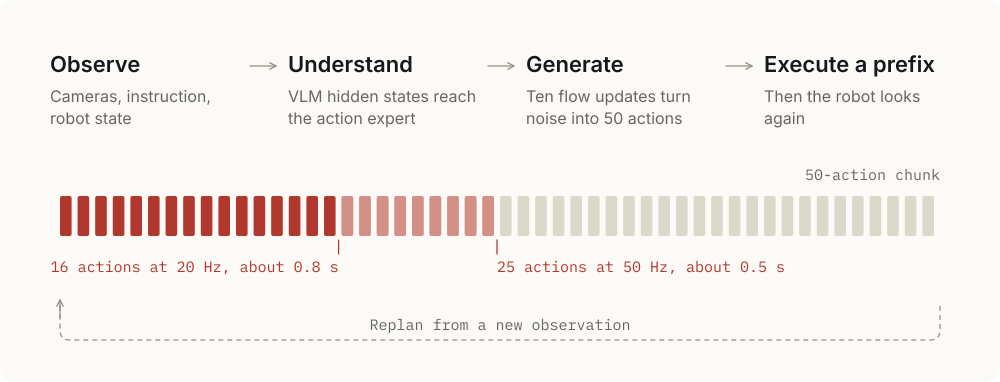
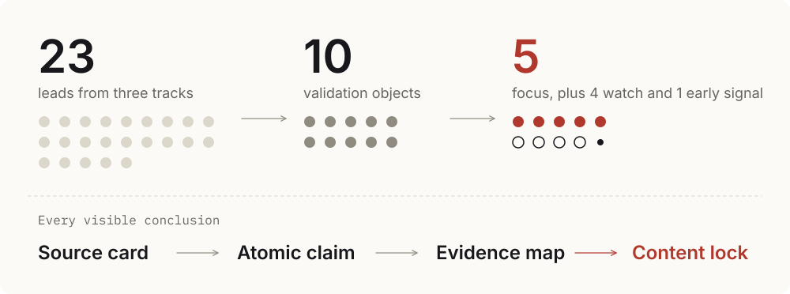

# Research Portfolio

**How robot models turn perception into action, and how those technical choices shape products and markets.**

Independent research and writing by **Theodore Ouyang**. I take a contested technical field, find the one question that separates its systems, and follow that question from the equations to the market.

Fixed repository version: [V_202611](https://github.com/130U/reserach-portfolio-since2026/tree/V_202611).

## Where the Future Enters

The labels “VLA” and “world-action model” hide more than they reveal. I compare robot models with three questions instead: what is the model trained to predict, what representation reaches the action generator, and what computation remains when the robot runs?

Those questions turn two product categories into one spectrum. DreamZero jointly generates future video and actions. VPP uses predictive visual features without fully drawing the future. Fast-WAM retains a single-pass world encoder, while GigaWorld-Policy makes action generation causally independent of its future-video branch.

The consequence is practical. Learning from visual dynamics can shape a policy even when that policy generates only actions at deployment, so latency, architecture, and the value of world modeling have to be compared at the point where prediction enters, never by the name on the model.

**[Read the comparison](articles/2026-08-03-from-vision-and-instructions-to-robot-actions/README.en.md)** · [Chinese edition](articles/2026-08-03-from-vision-and-instructions-to-robot-actions/README.zh-CN.md)

## π₀: The Interface Is the Durable Part

I follow π₀ from conditional flow matching to action chunks to real-world feedback. The equations explain how actions are generated. The execution loop explains how the robot stays responsive.

I argue that the design choice that lasts is the interface between a general semantic backbone and a continuous-control expert. That seam also points toward a complementary role for world models in planning and consequence evaluation.

**[Read the technical walkthrough](research/2026-08-02-pi0-vla-flow/README.en.md)** · [Chinese edition](research/2026-08-02-pi0-vla-flow/README.zh-CN.md)

## World Models: Callable Is Not Deployed

The Manifold landscape study examines World Labs, Odyssey, Runway, Decart, and NVIDIA Cosmos 3 using public information as of July 14, 2026. It is independent desk research and represents neither Manifold nor any company it discusses.

I designed it as a decision system instead of a report. It separates four states that market analysis usually collapses: worth investigating, technically qualified, strategically related, and worth one of five presentation slots. AI agents ran the parallel research and the mechanical checks. I owned the question, the qualification gates, the red-team revisions, the final selection, and the public wording.

My conclusion is that competition has moved beyond visual model quality to APIs, runtimes, deployment, integration, data rights, and total cost. Supply has split into three observable paths: publicly priced interfaces, application-controlled access, and downloadable or self-hosted components. The research found no customer-first-party confirmation of paid production adoption, renewal, or revenue for any of the five, which makes standard delivery units, shared validation, and deployment rights the work that matters next.

**[Read the study](research/2026-08-03-manifold-world-model-landscape/README.en.md)** · [Chinese edition](research/2026-08-03-manifold-world-model-landscape/README.zh-CN.md) · [Presentation](research/2026-08-03-manifold-world-model-landscape/source-snapshot/archive/manifold-world-model-landscape/10_deck/manifold_world_model_landscape_v1_4.pptx)

## How I Hold a Claim

A technical argument is only as strong as the status of its sentences, so I make that status visible. My reading of π₀ marks each passage as evidence from the paper, an author claim, a code snapshot, a plain-language explanation, or my own interpretation. In the world-model study, no source may support more than its atomic claim. Every work is published in English and Chinese.

[Research index](research/README.md) · [Article index](articles/README.md) · [Source materials](research/2026-08-03-manifold-world-model-landscape/source-snapshot/README.md) · [Reuse terms](research/2026-08-03-manifold-world-model-landscape/source-snapshot/NOTICE.md)
